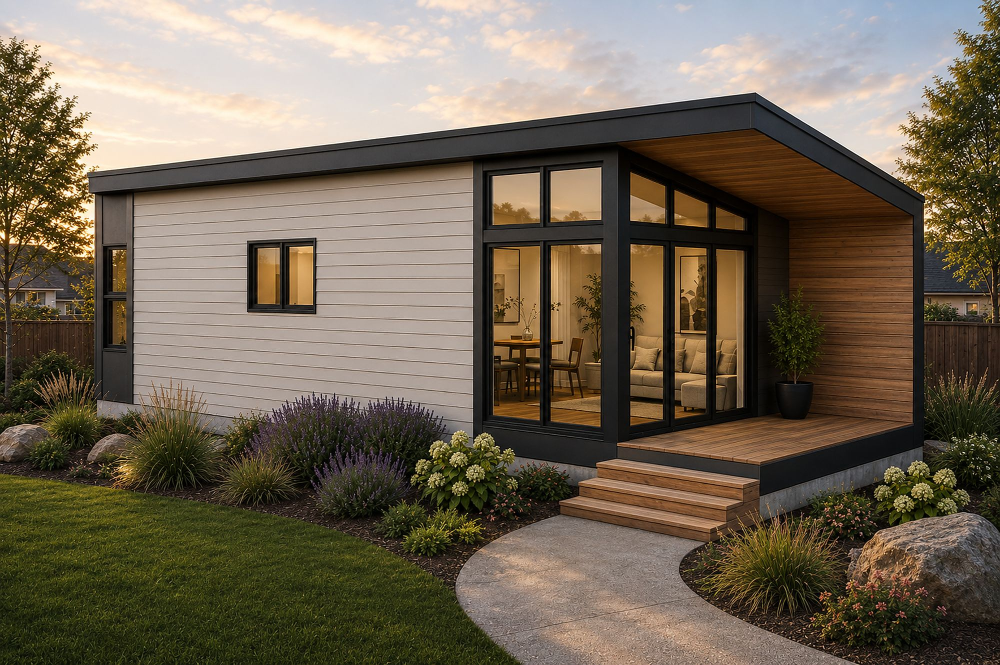

# Stoneward Construction static site

A plain HTML, one-CSS-file, small-JavaScript marketing site for Stoneward Construction, a licensed Utah residential contractor.

There is no build step, no framework, no package manager and no external resource. Open the pages from any static host or local web server.

## Files

```
index.html               Homepage
adus.html                All 33 plans grouped by series, with type, bedroom and size filters
finishes.html            The four finish series, one category at a time
how-it-works.html        Five-step process, who does what, budget
about.html               The owner's story and the service area
faq.html                 Questions and answers, grouped by topic
utah-adu-law-sb284.html  Plain-language guide to Utah's detached ADU law (S.B. 284)
american-fork-adu.html   American Fork's adopted detached ADU rules and plans that fit
gallery.html             Completed homes and a rendering of every plan, with a lightbox
contact.html             Mailto contact form, call and email actions
404.html                 Not-found page
robots.txt               Crawler rules and sitemap location
sitemap.xml              Public page list
README.md                This file
assets/
  css/styles.css         The only stylesheet
  js/config.js           Contact details, the single source of truth
  js/plans.js            The plan records
  js/main.js             Header, filters, plan cards, mailto form, JSON-LD
  img/                   Photos, floor plans and the gallery
scripts/
  check.py               Stdlib-only site checker
```

## Edit contact details

Open `assets/js/config.js`. The phone, email and service area are stored there once and used by the header, footer, contact page, structured data and click-to-call links.

The three contact values are each marked `VERIFY WITH OWNER`. Confirm them before launch. Do not repeat the phone number or email in the HTML, because the page scripts fill them in from this file.

If you change the site URL, update `siteUrl` in `config.js`, the canonical and Open Graph tags in each HTML page, and `sitemap.xml`.

## Edit plans

Open `assets/js/plans.js`. Each record uses this shape:

```js
{ name: "Mysa 500", sqft: 497, beds: "1", baths: "1", photo: "mysa-500.jpg" }
```

- `name` is shown on the card and passed to `contact.html?plan=...`.
- `sqft` is a number, used by the plan cards and the size filters.
- `beds` and `baths` are strings. A range is written with a hyphen, such as `"1-2"`.
- `photo` is a filename in `assets/img/`.
- Keep the field names and the array order intact unless you also update the filter logic in `main.js`.

Prices live in one place: the `price` field in `assets/js/plans.js` (Designer Series planning price, delivered and set in Utah, from the factory sheet; `window.PRICE_DATE` says when). The pages render prices from that data, so do not type dollar amounts into the HTML (the checker blocks it). Update every price and the date together when the factory sheet changes.

The homepage featured strip uses the plans named in `initFeaturedPlans()` in `assets/js/main.js`. If those names change, update that list.

## Add photos

See `assets/img/README.md` for the full list of filenames, suggested sizes and subjects.

Each slot looks like this:

```html
<figure class="ph ph--warm" data-photo="hero.jpg">
  
  <figcaption>Completed ADU, Utah</figcaption>
</figure>
```

The `.jpg` files in `assets/img/` are empty placeholders so every local link resolves before photography exists. Replace an empty file with a real JPEG of the same name. When the image loads, it covers the styled gradient. When it is missing or cannot be read, `onerror` hides the image and the gradient and caption show.

For plan photos, update the `photo` value in `plans.js` if you rename a file.

## Preview locally

From the site root:

```bash
python3 -m http.server 8099
```

Then open `http://localhost:8099/` in a browser.

Do not preview by double-clicking the HTML files if you want the contact form and plan filters to behave exactly as they will on a server. The site uses only relative paths, so it also works from a subfolder.

## Run the checker

```bash
python3 scripts/check.py
```

The checker uses only the Python standard library. It verifies that every internal `href` and `src` resolves to a file, checks required page metadata, rejects external URLs, and checks for dollar amounts and em or en dashes. It prints `OK` and exits 0 when the site passes.

## Contact form

`contact.html` does not post to a server. On submit, `main.js` reads the fields, builds a `mailto:` link to the address in `config.js`, and opens the visitor's email app with the details in the message body. Nothing is sent until the visitor presses send. The direct call and email buttons work without the form.

## Structured data

Each page has a minimal `<script type="application/ld+json" id="business-schema">` object with the business name. `main.js` replaces it at load time with the full `LocalBusiness` record built from `config.js`: name, URL, telephone, email, office address and area served. The office address is the same suite the owner's other businesses use. Keeping the contact fields generated from `config.js` avoids duplicating them in six HTML files.

## Deploying

The live site is a Cloudflare Pages project (direct upload). Pushing to main does not publish it; run the deploy script from the PC after merging. No build command is required. Keep `robots.txt` and `sitemap.xml` at the site root and make sure the host serves `404.html` for not-found requests if you want the custom page.

Before launch, replace the placeholder photos, confirm the three `VERIFY WITH OWNER` contact values and run `python3 scripts/check.py`.
